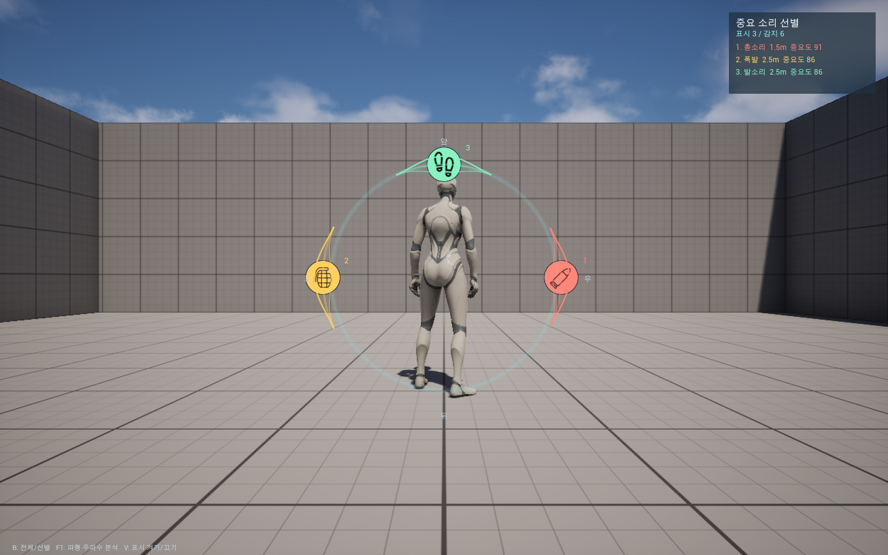

# SoundCompass

게임공학 프로젝트의 **동시 발생 소리의 중요도 선별 시각화** 기능입니다. Unreal Engine **5.8**에서 실행합니다.

`main`의 실험 맵을 기반으로 구현하고 `AHNINTAE`의 원본 마커·아이콘·머티리얼을 연결했습니다. **소리 방향을 중심으로 50° 범위에만 파형**을 표시하며, 종류별 색상과 큰 방향 아이콘으로 구분합니다. 짧은 소리도 마지막 감지 후 **0.6초 유지하고 0.8초 동안 부드럽게 줄어들며 사라집니다**.

## 실행

`SoundCompass.uproject`를 열고 기존 `ThirdPerson/Lvl_ThirdPerson` 맵에서 **Play**를 누릅니다. 처음 열 때 C++ 모듈을 재빌드합니다.

| 키 | 기능 |
| --- | --- |
| **B** | 중요 소리 선별 ↔ 전체 소리 표시 |
| **F1** | 파형·주파수·후보 소리 분석 화면 |
| **V** | 시각화 전체 켜기/끄기 |

기본 설정은 **중요도 0.50 이상, 상위 3개**입니다. 종류별 중요도에 거리·크기를 반영하며, 큰 환경음보다 조용한 위험 소리를 우선할 수 있습니다. 방향 파형은 소리별 측정 엔벌로프 이력이며, F1 분석 화면에서 실제 전체 출력 PCM 파형을 확인할 수 있습니다. 아이콘은 기본 52 크기로 조용한 소리도 읽기 쉽게 표시합니다.

등록된 공간 음원은 **raycast 기반 소리 감쇠**를 기본 사용합니다. 벽이나 닫힌 문이 청취 경로를 막으면 음량을 **35%**, 저역 통과 필터를 **1,500 Hz**로 조절합니다. 문을 열거나 장애물 밖으로 이동하면 **0.15초** 동안 원래 소리로 복원합니다. 시각화의 추정 크기·중요도에도 같은 가림 설정을 반영합니다. 음원에 이미 설정된 occlusion 값은 유지하며, UI·비공간 소리에는 기본 감쇠를 추가하지 않습니다.

[기능·설정·UI 연결·실험 비교·검증 안내](Docs/SOUND_VISUALIZATION_KO.md)

UE 5.8.2 / Mac에서 빌드 및 실제 맵 실행 검증을 통과했습니다. 신호·중요도 계산 47개와 방향 표시·유지·감쇠 테스트 32개, 실제 오디오 스레드의 raycast 감쇠·필터·복원 검사도 통과했습니다. 자세한 기록은 [검증 기록](Docs/VERIFICATION.md)을 참고하세요. Windows 빌드는 별도로 확인해야 합니다.

음원 출처는 [기존 음원 크레딧](Content/SoundTest/CREDITS.md)을 참고하세요.
